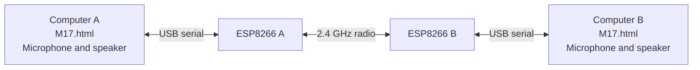

# ESP · M17 — Offline ESP8266 Radio Terminal

An experimental 2.4 GHz radio project combining a universal ESP8266 firmware with a self-contained browser terminal for voice, audio DTMF and SMS.

**One node = one ESP8266 running `M17Modem.ino` + one browser page running `M17.html`.**

Flash the same sketch to every board. Open the same HTML file for every node. Each page manages one board, its callsign, microphone, audio output and radio settings.

The default **Simplified mode** brings connection setup, push-to-talk, the DTMF keypad and SMS into one screen. The existing **Messages**, **Voice**, **Packets**, **BERT** and **Diagnostics** tabs remain available.

> This is an experimental implementation. M17 framing and Codec2 support do not establish certified RF compliance or demonstrated interoperability with third-party M17 radios. The frequency-tracking exchange described below is specific to this project.

## Contents

- [How it works](#how-it-works)
- [Requirements](#requirements)
- [Repository layout](#repository-layout)
- [Quick start](#quick-start)
- [Firmware installation](#firmware-installation)
- [Opening the terminal](#opening-the-terminal)
- [Voice, DTMF and SMS](#voice-dtmf-and-sms)
- [Multiple nodes](#multiple-nodes)
- [Radio settings and automatic gain](#radio-settings-and-automatic-gain)
- [Frequency tracking and calibration](#frequency-tracking-and-calibration)
- [Advanced features](#advanced-features)
- [Stored settings and privacy](#stored-settings-and-privacy)
- [Diagnostics and troubleshooting](#diagnostics-and-troubleshooting)
- [Validation and limitations](#validation-and-limitations)
- [Updating and verifying files](#updating-and-verifying-files)
- [Credits and licenses](#credits-and-licenses)

## How it works



The browser handles the application, M17 frame encoding/decoding, Codec2, audio devices, optional Stream cryptography and the user interface. Workers and an AudioWorklet keep codec and audio processing separate from the main interface.

The ESP8266 handles the radio timing, 4FSK generation/reception, signal processing and supported carrier corrections. The implementation uses the ESP8266 radio PHY directly. It does not send the conversation as ordinary Wi-Fi/IP traffic and does not require an SSID, router or Internet service.

USB carries commands and frame data between each browser page and its own ESP. The conversation between nodes travels over the radio.

The intended radio timing is 4,800 symbols per second with 40 ms frames. The on-air format is based on the [M17 protocol specification](https://spec.m17project.org/files/M17_spec.pdf); RF interoperability still requires separate verification.

### Main features

- One universal firmware for all nodes; per-node configuration comes from the browser.
- A single offline HTML file with its scripts, Codec2 WebAssembly, Workers, styles and notices embedded.
- Push-to-talk voice using Codec2 3200 or Codec2 1600.
- A 16-key DTMF keypad and programmable tone sequences sent through Codec2 audio.
- Addressed SMS and broadcast SMS.
- Hardware automatic RX gain when supported by the firmware.
- Optional reference-based frequency-drift tracking with bounded corrections.
- Advanced Packet/data Stream, PRBS9 BERT, metadata and Stream security controls.

## Requirements

| Item | Requirement |
|---|---|
| Radio boards | At least two ESP8266 boards for a radio link. The documented build target is a 4 MB D1 mini. |
| USB | A working USB data connection for each board, including its USB-to-serial driver if required. |
| Computer | One or more computers running a desktop browser with Web Serial, Web Audio, AudioWorklet and WebAssembly support. |
| Browser | Use desktop Google Chrome or Microsoft Edge. Browser policy and OS permissions must allow serial and audio access. |
| Audio | A microphone for live voice and a speaker or headphones for listening. DTMF generation does not require a microphone. |
| Firmware tools | Arduino IDE or Arduino CLI with **ESP8266 Arduino core 3.1.2**. |
| Internet | Needed to obtain the project and install development tools. Normal operation of the downloaded HTML is offline. |

The microphone and speaker belong to the **computer/browser page**, not to GPIO pins on the ESP8266. This firmware requires no external audio codec, wired microphone, speaker amplifier or additional RF module.

ESP32 is not supported by this sketch. Other ESP8266 boards may need separate validation; selecting an ESP8266 target alone does not establish compatibility with every board or flash configuration.

Web Serial asks the user to choose and authorize a device. See the official [Chrome Web Serial documentation](https://developer.chrome.com/docs/capabilities/serial) for browser API details.

## Repository layout

Keep these paths when publishing or downloading the minimal project:

```text
.
├── README.md
├── M17.html
└── M17Modem/
    └── M17Modem.ino
```

| File | Purpose |
|---|---|
| [M17.html](M17.html) | The complete offline terminal. Download it and open it locally in the browser. |
| [M17Modem/M17Modem.ino](M17Modem/M17Modem.ino) | The self-contained Arduino sketch. Compile and upload the same file to every ESP. |

The sketch folder and file must both be named **M17Modem**. The HTML is opened on the computer; it is not uploaded to the ESP or to an ESP filesystem.

## Quick start

1. Download the repository and extract it from its ZIP archive.
2. Install ESP8266 Arduino core **3.1.2** and use the build settings below.
3. Upload `M17Modem/M17Modem.ino` to each board.
4. Close Arduino Serial Monitor and any other program using the boards' serial ports.
5. Open the downloaded `M17.html` in desktop Chrome or Edge. **Simplified mode** opens by default.
6. Click **Guided setup**, choose this node's serial port and allow microphone access when requested.
7. Select the microphone and output device for this page. Use **Test sound** to check the output.
8. Repeat in a separate page for the other ESP. Use distinct callsigns, the same frequency and the same CAN.
9. Send a short SMS first. Confirm that it appears in the receiving node's conversation, then test voice and DTMF.

For a first test, use the default nominal frequency of **2437.000 MHz**, CAN **0**, unencrypted operation and **Everyone (@ALL)** as the recipient. Saved settings may override these initial values.

Frequency-drift tracking can remain disabled while making the initial connection. It requires an explicitly configured reference and qualified measurements; it is not a prerequisite that the interface invents automatically.

## Firmware installation

### Install the ESP8266 board package

1. Open Arduino IDE preferences.
2. Add this entry to **Additional Boards Manager URLs**:

   ```text
   https://arduino.esp8266.com/stable/package_esp8266com_index.json
   ```

3. Open **Boards Manager**, find **esp8266 by ESP8266 Community**, select version **3.1.2** and install it.

This uses the upstream [ESP8266 core installation procedure](https://arduino-esp8266.readthedocs.io/en/3.1.2/installing.html). Keep the specified version: this project uses low-level radio functionality tied to that core and SDK.

### Compile and upload with Arduino IDE

Open `M17Modem/M17Modem.ino` and configure:

| Setting | Value |
|---|---|
| Board | **LOLIN(WEMOS) D1 R2 & mini** |
| ESP8266 core | **3.1.2** |
| CPU Frequency | **160 MHz** |
| Flash Size | **4MB (FS:none OTA:~1019KB)**, corresponding to `eesz=4M` |
| MMU | **16KB cache + 48KB IRAM (IRAM)**, corresponding to `mmu=4816` |
| Debug port | **Disabled** |
| Port | The port belonging to the board being flashed |

The board name and menu values are defined in the pinned [ESP8266 3.1.2 board definitions](https://raw.githubusercontent.com/esp8266/Arduino/3.1.2/boards.txt).

Click **Verify**, then **Upload**. Repeat for each board using the same sketch. If a board requires a manual bootloader/reset sequence, follow that board's procedure.

No additional Arduino libraries are required. `Arduino.h`, `ESP8266WiFi.h` and `user_interface.h` come with the installed ESP8266 core. The required project radio/DSP components are combined into the INO.

The sketch contains compile-time checks for the ESP8266 architecture, 160 MHz CPU and 48 KB IRAM. A CPU or MMU error should be resolved by choosing the required settings.

**Upload speed and application serial speed are different settings.** The running firmware communicates with the HTML at **115200 baud, 8N1**, without hardware flow control. The browser configures this itself. If uploading is unreliable, a lower Arduino upload speed such as 115200 may help.

### Optional: compile and upload with Arduino CLI

Run these commands from the repository root after installing [Arduino CLI](https://docs.arduino.cc/arduino-cli/getting-started):

```sh
arduino-cli core update-index --additional-urls https://arduino.esp8266.com/stable/package_esp8266com_index.json
arduino-cli core install esp8266:esp8266@3.1.2 --additional-urls https://arduino.esp8266.com/stable/package_esp8266com_index.json
arduino-cli board list
arduino-cli compile --fqbn "esp8266:esp8266:d1_mini:xtal=160,eesz=4M,mmu=4816" --output-dir build M17Modem
arduino-cli upload --fqbn "esp8266:esp8266:d1_mini:xtal=160,eesz=4M,mmu=4816" --input-dir build --port COM7 M17Modem
```

Replace `COM7` with the actual upload port. On Linux or macOS, use the appropriate device path. Repeat the upload command for each board.

The build creates `build/` locally. The upload command writes the compiled firmware and does not compile it again; see the official [compile](https://arduino.github.io/arduino-cli/1.5/commands/arduino-cli_compile/) and [upload](https://arduino.github.io/arduino-cli/1.5/commands/arduino-cli_upload/) references.

### After uploading

Close Serial Monitor and other serial tools before connecting the HTML. The application serial stream is binary, so a text terminal is not the user interface.

The firmware initializes its radio hardware but leaves reception disabled until the browser establishes the session, applies configuration and starts RX.

## Opening the terminal

Download the assembled **M17.html** and open that local file directly. A GitHub file preview displays source; it does not run the terminal. The unassembled development `index.html` is also different from the standalone file and expects supporting files.

No local web server, Node.js runtime, Python bridge, CDN, account or Internet connection is required for normal use of the standalone terminal. Codec2 and its WASM binary are already embedded. There is no codec file to select or upload.

### Guided setup

**Guided setup** performs the following sequence:

1. Request the ESP's serial port if it is not connected.
2. Enable supported automatic features using the existing configuration.
3. Request microphone access.
4. Initialize audio playback and Codec2.
5. Refresh the device lists and let you select the output.

Browser permissions still require the user's approval. If a browser requires another click for a particular step, use the individual **Choose serial port**, **Allow microphone**, **Enable playback** and **Test sound** controls.

Device names may become available only after microphone permission is granted. Select the intended microphone and speaker for **this page**. Non-default speaker selection depends on browser support and permission; otherwise choose the output in the operating system. See [Chrome's Web Audio output-device documentation](https://developer.chrome.com/blog/audiocontext-setsinkid?hl=en).

If you change the microphone after granting access, click **Allow microphone** again before using PTT.

Microphone access is reused for the current session. Choose an option allowing access during the current visit when the browser offers it. **Release** closes the microphone session; changing the microphone, disconnecting the board or leaving the page also releases it.

### One page per board

Several boards can use the same computer, but each needs its own page and a different serial port. Each page has its own audio engine and node settings. A serial port cannot be owned by two pages or by the browser and Serial Monitor at the same time.

Optional USB forwarding such as VirtualHere must make the device appear as a usable serial port on the computer running the browser. USB forwarding configuration is external to this project; it is not required for a direct USB setup.

## Voice, DTMF and SMS

### Live voice

1. Connect the node and authorize its microphone.
2. Choose **Everyone (@ALL)** or a **Specific callsign**.
3. Enable playback on the receiving page and select its speaker.
4. Hold **Hold to talk**, speak, then release it to finish the transmission.

The microphone is disabled and disconnected from the processing input outside PTT. Keeping permission for the session does not continuously transmit audio.

In Simplified mode, local playback is muted during PTT and restored after transmission stops. The page also requests browser echo cancellation for the microphone and reports whether activation is confirmed. Returning to the original tabs restores the previous microphone constraint.

Use headphones for close-proximity testing. Browser echo cancellation cannot guarantee removal of audio from another receiver playing in the same room, or duplicate playback from several pages using one speaker.

The Space shortcut works when the relevant view is active and keyboard focus is outside text fields, selects, buttons and editable content. **Stop TX**, losing the page's focus or leaving the simplified view interrupts its active transmission. Keep the transmitting page in the foreground.

Codec mode is selected in the existing **Voice** tab:

| Mode | Current behavior |
|---|---|
| Codec2 3200 | Voice frames using the 3200 bit/s speech mode. |
| Codec2 1600 | The voice-plus-data frame format using 1600 bit/s speech. The current audio worker leaves the auxiliary data bytes zero; there is no general simultaneous data-channel editor. |

### DTMF through Codec2

Use the keypad for an individual tone or enter a sequence and click **Send**. Supported keys are `0`–`9`, `*`, `#` and `A`–`D`; lowercase letters are normalized. A sequence contains **1–64 keys**.

| Timing | Default | Allowed range |
|---|---:|---:|
| Tone duration | 200 ms | 40–2000 ms |
| Gap between tones | 100 ms | 40–1000 ms |

Timing settings are available in the original **Voice** tab's DTMF section and are shared with Simplified mode. **Stop tones** cancels a sequence.

The browser generates the two audio frequencies before Codec2 encoding. They travel in the same vocal radio Stream as other audio. The receiver plays decoded audio normally: the project does not replace tones with key-data packets or regenerate clean DTMF at reception.

No microphone is required to generate DTMF. Codec2 is lossy and can alter the tones; recognition by an external DTMF decoder is not guaranteed. Test the selected mode and timing with the intended receiver.

### SMS

Choose a recipient, enter the message and click **Send**. The limit is **821 UTF-8 bytes**, not 821 characters; accented characters and emoji can use multiple bytes.

SMS uses M17 Packet protocol `0x05`. The receiving page shows messages accepted for its destination/CAN settings.

**Sent locally** or **SMS handed to modem** confirms the local transmission path. It is not a radio delivery acknowledgement. Check the receiving node's conversation to establish reception.

An empty or invalid specific destination blocks transmission instead of silently changing it to broadcast.

## Multiple nodes

Every board runs the same INO. No firmware variants for node A, B or C are needed.

After connection, the page restores saved settings using the board's MAC/chip identity. Without saved settings, it derives an initial callsign from that identity, normally `N` plus six hexadecimal chip-ID digits. You can change it to a distinct valid callsign of up to nine characters.

Use the same nominal RF frequency and **CAN** on nodes that should communicate. CAN ranges from **0 to 15** and is an application access/filter value; it is not a different RF frequency or an encryption key.

| Transmitter | Destination | Normal receiving pages |
|---|---|---|
| `NODE-A` | `NODE-B` | `NODE-B` |
| `NODE-A` | `Everyone (@ALL)` | Other listening nodes on the matching frequency/CAN |
| `NODE-C` | `NODE-B` | `NODE-B` |

The normal application filter accepts its own callsign and `@ALL` on the chosen CAN. **Monitor: all destinations / CANs** bypasses that application filter for inspection; it does not tune to all RF frequencies.

The design is not fixed to two or three nodes, but it does not provide automatic peer discovery, mesh routing or unlimited channel capacity. The radio is **half duplex**: coordinate users so one node transmits at a time on a shared channel. Several simultaneous transmitters can collide.

For several receiver pages on one computer, select appropriate outputs or enable playback on only the page you want to hear. Otherwise the same transmission may be played more than once.

## Radio settings and automatic gain

These are the initial HTML values before saved settings are restored:

| Setting | Initial value / meaning |
|---|---|
| Nominal RF frequency | **2437.000 MHz** |
| CAN | **0** |
| Destination | **@ALL** |
| RX LO offset | **+5000 Hz** |
| Static TX correction | **0 Hz** |
| TX attenuation | **64**, a raw hardware code |
| RX gain | Auto is selected when supported by the connected firmware |

The running firmware accepts nominal center frequencies from **2412 to 2462 MHz**, inclusive. The HTML numeric field's wider display limits do not extend that firmware range. The ordinary static TX correction is limited to **±12,000 Hz**; larger coarse frequency tracking uses a separate firmware command.

These are implementation limits, not a statement of regional operating authorization or a guarantee of a clean RF spectrum.

Automatic RX gain returns gain control to the hardware PHY when supported. The interface distinguishes **requested** automatic gain from activity confirmed by the modem's status. Manual gain indices are **0–59**.

Gain indices and attenuation codes are not calibrated dB, dBm or percentages. In particular, attenuation code `64` does not mean 64 dB.

AGC helps handle changing signal levels, but it does not guarantee operation at every separation or prevent every analog saturation condition. For near/far experiments, use suitable placement, conservative levels and the received error/queue indicators. Maximum range has not been established for this release.

## Frequency tracking and calibration

### What is automatic

The firmware performs its local receive-side frequency/symbol processing. The optional browser controller can also learn transmitter corrections from a specifically chosen reference node and apply a bounded model during later transmission.

Simplified mode enables supported automatic gain and uses an existing valid tracking configuration. It does not invent a reference, manufacture a CFO measurement or mark calibration successful merely because a setting was enabled. Without the necessary reference or firmware capabilities, tracking remains disabled and ordinary voice operation remains available within the receiver's acquisition limits.

### Why a measured prior is required

The native CFO estimate is ambiguous **modulo 38,400 Hz**. The nominal frequency and RX offset alone do not identify the physical alias branch.

The reference node therefore needs a **measured and qualified CFO prior for each follower's callsign**. Its uncertainty must be strictly below **19,200 Hz**, and the actual measurements must also pass the controller's quality checks.

There is no universal number to copy for every ESP8266. Do not mark a guessed value as qualified or reuse another board's bench measurement.

Obtaining the initial prior requires a suitable frequency-measurement procedure. The minimal interface does not automatically obtain that unambiguous coarse prior.

### Configure a reference and follower

Open **Options and advanced settings** and the frequency-reference controls, or open **Carrier drift tracking** in the original interface.

On the **reference node**:

1. Use the same nominal frequency and CAN as the follower.
2. Set **Role** to **Reference** and enable drift tracking.
3. For each follower, enter its exact **CFO prior source**, measured **Expected CFO · Hz** and appropriate **Uncertainty · Hz**.
4. Select **Measured and qualified prior** only for an actual qualified measurement, then click **Add / replace this prior**.
5. Leave **Reference qualified as a standard** unchecked when using an ordinary ESP as a relative reference. Checking this box is a declaration; it does not measure or certify a frequency standard.

On the **follower node**:

1. Set **Role** to **Follower**.
2. Enter the reference node's exact **Reference callsign**.
3. Enable drift tracking and click **Apply to node**.
4. Click **Calibrate · 1 s data burst**.

The calibration sends an LSF followed by 25 data frames, without using the microphone. It waits for a new accepted report after the actual end of transmission. There are up to three attempts, each with a fresh nonce and a report wait of up to three seconds. Canceling, disconnecting or starting other traffic interrupts the operation.

Changing callsigns requires updating the corresponding reference fields and prior dictionary keys.

### Multiple followers and protocol scope

Each follower selects one reference. Several followers can share that reference if it has a separate qualified prior for each source. Calibrate them sequentially: the reference handles one armed measurement at a time.

The control exchange is project-specific application data, identified by `M17F`, carried inside M17 RAW Packets with protocol identifier `0`. Third-party M17 equipment does not automatically implement it. Nonces correlate transactions and reject stale/mismatched feedback; they do not authenticate the sender.

Voice or a sufficiently long broadcast can first send a directed measurement request to its selected reference, with directed feedback afterward. This is separate from a delivery acknowledgement and does not cause every broadcast listener to correct the transmitter.

### Correction limits

| Controller limit | Current default |
|---|---:|
| Accumulated correction | ±120,000 Hz |
| Correction per accepted report | ±5,000 Hz |
| Correction gain | 0.5 |
| Maximum tracked slope / correction slew | 2,000 Hz/s |
| Minimum qualified measurements | 5 |
| Minimum observation span | 160 ms |
| Maximum accepted report age | 2 seconds |
| Maximum predictive-model age | 10 seconds |
| During-TX prediction horizon | 3 seconds |
| Post-EOT guard interval | 80 ms |

An ESP cannot receive an independent live correction while transmitting on its half-duplex radio. During TX, the controller uses a bounded prediction from previous qualified feedback. A relative reference is not absolute frequency calibration.

## Advanced features

The original tabs remain available alongside Simplified mode:

| Tab | Purpose |
|---|---|
| Messages | SMS composition, byte count and local transmission control. |
| Voice | Codec mode, microphone/speaker selection, playback, PTT and detailed DTMF timing. |
| Packets | Binary/text Packet content, file import and raw data Streams. Packet content is limited to 822 bytes plus its protocol identifier; the raw Stream input has a local 64 KiB transmission limit. |
| BERT | Continuous PRBS9 test data and received bit-error statistics. Default duration: 10 seconds; allowed range: 1–1800 seconds. |
| Diagnostics | Radio states, received symbol information, counters, logs and local self-tests. |

### Stream security and metadata

Stream options include unencrypted operation, a standard scrambler, AES-CTR and optional P-256 signatures. The scrambler is not a replacement for cryptographic confidentiality.

| Input | Expected format |
|---|---|
| AES key | 16, 24 or 32 bytes, entered as hexadecimal |
| P-256 private key | 32 bytes, entered as hexadecimal |
| Receive public key | 64 bytes containing X and Y, entered as hexadecimal |
| Scrambler seed | 1–3 bytes, entered as hexadecimal |

These settings apply to voice/data **Streams**. They do not encrypt SMS or ordinary Packet mode. Both ends need compatible options and the required keys.

Metadata can contain text or manually entered GNSS information. The current transmit text field accepts at most **13 UTF-8 bytes**. The manual GNSS fields do not imply that a GPS receiver is connected.

## Stored settings and privacy

When browser storage is available, non-secret settings are stored by the node's MAC/chip identity. These include callsigns, CAN, radio/gain settings, codec mode, audio device choices, DTMF timing and drift configuration/priors.

Cryptographic keys and the entered DTMF sequence are not persisted. Keys remain in the page's memory, are not sent to the ESP and are excluded from the application's log export. Exported event logs can still contain message contents and diagnostic data.

Storage and permissions depend on the browser/profile and local-file origin handling. If persistent storage is unavailable, settings cannot be restored across page sessions. There is no cloud account or remote settings service.

## Diagnostics and troubleshooting

### Run the offline self-test

Open **Diagnostics** and click **Check terminal · local self-tests**. The checks exercise:

1. Local SMS encoding/decoding in the protocol Worker.
2. Codec2 3200 encoding/decoding.
3. Codec2 1600 encoding/decoding.
4. An AES-CTR round trip.
5. P-256 signing and verification.

These checks do not request a microphone, open a serial port or transmit RF. They establish that the local terminal components work, not that a radio link is receiving correctly.

### Common issues

| Symptom | What to check |
|---|---|
| ESP missing from the port picker | Use a USB data cable, confirm the OS sees the serial adapter, install the board's driver if needed, and check USB forwarding ownership when applicable. |
| Port busy or access denied | Close Serial Monitor, other terminal programs and any other page holding that same port. |
| Web Serial unavailable | Open the downloaded local HTML in a supported desktop Chrome/Edge environment. Browser or organization policy may restrict hardware access. |
| CPU or MMU compilation error | Use core 3.1.2, D1 mini, CPU 160 MHz and MMU 16KB cache + 48KB IRAM. |
| Radio configuration rejected | Keep the nominal frequency inside 2412–2462 MHz and ordinary static TX correction inside ±12 kHz; wait until RF is idle. |
| No received SMS | Check nominal frequency, CAN, callsigns and recipient filtering. A local Sent status is not a remote acknowledgement. |
| No received sound | Enable playback on the receiving page, select the intended output, test it and check browser/OS audio permissions and volume. |
| Microphone asks for permission again | Allow access for the current visit when offered. Reopening, releasing or changing the microphone, or revoking permission can require a new grant. |
| Echo or duplicated audio | Use headphones, avoid nearby receiver speakers being picked up by a transmitting microphone, and avoid several pages playing into the same speaker. Check the actual echo-cancellation status. |
| DTMF is heard but not recognized | Codec2 can deform tones. Test longer tone/gap settings and both codec modes with the actual DTMF decoder. |
| Frequency tracking waits for a reference | Configure the roles, exact callsigns and a measured qualified prior on the reference. Do not substitute an arbitrary zero CFO. |
| Calibration never confirms | Check the directed radio path, reference configuration, CAN, prior quality and matching firmware capabilities. Calibration requires a new report after EOT. |
| Queue errors, underruns or poor audio | Keep the page foregrounded, check USB reliability, avoid competing transmitters and inspect the Diagnostics counters. |

When reporting an issue, include the board/core configuration, browser/OS, firmware capability version, nominal frequency/CAN, relevant counters and a short event log. Avoid including private keys.

## Validation and limitations

The documented English HTML release passed:

- **149 functional tests** against the English modules, with presentation-language expectations adapted.
- **152 original source tests**, including the original preservation checks.
- **678 reference checks**, including unchanged variable/function identifiers, DOM IDs, technical attributes, import paths and DOM/event/message references.
- **53 checks on the packaged HTML**, covering default Simplified mode, all existing tabs and both DTMF keypads.
- Five embedded self-tests using three real Workers, plus Codec2 3200/1600 and generated DTMF checks.

The English translation preserved variable names, identifiers, machine/protocol values and the Codec2 WASM binary. Display-dependent SMS/listening filters were translated together with their producers and checked for consistency.

Earlier development tested directed and broadcast exchanges with three ESP8266 nodes using the unchanged firmware, one transmitter at a time. Those historical bench results do not constitute a new RF campaign for the current English/simplified HTML, a range specification or certification with third-party M17 hardware.

The minimal repository provides the runtime files and embedded self-tests. The full development test harness and historical bench reports are separate from those runtime files; no nonexistent test or VM-launch scripts are needed for installation.

Current practical limits include half-duplex operation, possible collisions, no ordinary SMS delivery ACK, browser-dependent audio permissions/output selection, no general auxiliary-data editor for Codec2 1600, and no demonstrated third-party RF interoperability for this release.

## Updating and verifying files

For an HTML-only update, close the old page and open the replacement `M17.html`. An HTML update does not require reflashing an unchanged INO.

The checksums below identify the documented English delivery. Later intentional releases may have different hashes.

| File | SHA-256 |
|---|---|
| `M17.html` | `80cf944214ad823f4e2df22c2a553778054c1ad1d8fb68adc68c4b2b7ae78b0a` |
| `M17Modem/M17Modem.ino` | `1f106e7b7c09fa8c17b66d8b092cab3d7136a8bf90436faeceb6d033cc1db910` |

PowerShell:

```powershell
Get-FileHash -Algorithm SHA256 .\M17.html
Get-FileHash -Algorithm SHA256 .\M17Modem\M17Modem.ino
```

On systems providing `sha256sum`:

```sh
sha256sum M17.html M17Modem/M17Modem.ino
```

The terminal's JavaScript/Worker source snapshots, source references and license texts are embedded in the HTML. The universal firmware source and its notices are in the INO. Documentation changes do not require changing either executable file.

## Credits and licenses

The project implementation is marked **GPL-3.0-or-later**. Third-party components retain their own licenses and notices. Preserve the embedded notices when publishing the project, and include the relevant license files with a fuller source distribution.

| Component / reference | Role and pinned provenance |
|---|---|
| [kaboom748/esp8266_WLAN_PHY](https://github.com/kaboom748/esp8266_WLAN_PHY) | RF primitives, I/Q estimation and hardware gain-control research. Studied base: `5e67a9f150d578cce000749b9fa8db27e9f4f98d`. |
| [SP8ESA/ESP8266_2.4GHz_SSB_TRX](https://github.com/SP8ESA/ESP8266_2.4GHz_SSB_TRX) | Fractional-generation/dithering reference, MIT. Reference: `a5bc0f3dcf3f2ef9fabe61e0bdf4ad8158166b3e`. |
| [M17 specification](https://spec.m17project.org/files/M17_spec.pdf) and [libm17](https://github.com/M17-Project/libm17) | Protocol/reference implementation. libm17 1.4.1 reference: `e1f0f5ca5bfe2dd98eeda8e945725d505b7d6aae`. |
| [Codec2](https://github.com/drowe67/codec2) | Embedded speech codec, LGPL-2.1 notices included. Source: `67f31bce663caef85abb5dd2df62fb996b246c05`. |
| [codec2-emscripten](https://github.com/rameshvarun/codec2-emscripten) | WASM build reference: `68e323e8659a24efe600422861c3b50b3944e1eb`. |
| Noble curves 1.8.2 / hashes 1.7.2 | Embedded cryptographic primitives, MIT. |
| ESP8266 Arduino core 3.1.2 and its SDK | Required firmware platform; upstream component licenses apply. |

The HTML's **Embedded sources, versions and licenses** section and the firmware's embedded notices contain further provenance. Upstream project references describe their own implementations; they do not certify this port.

